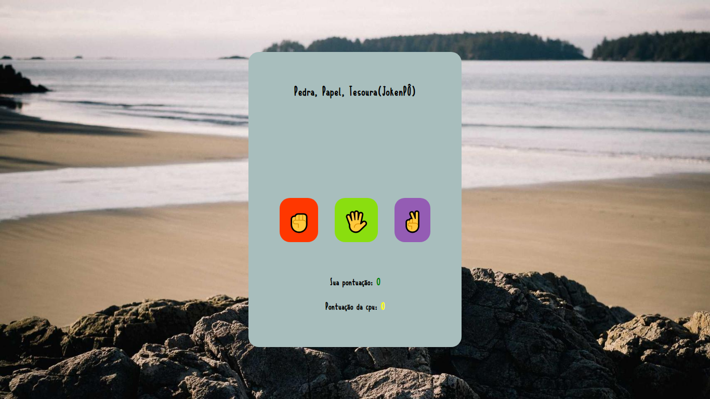
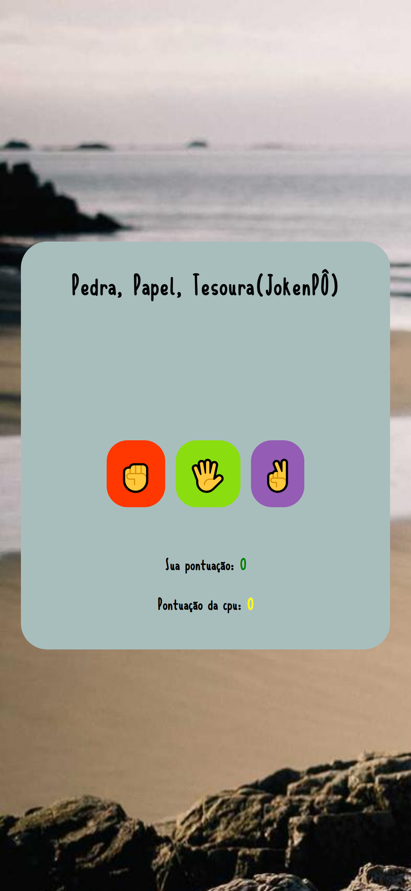

<h1> 💻Jogo dinâmico com ferramentas simples de JS. Projeto de aula <a href="https://www.devclub.com.br" target="_blank">DevClub</a>😁</h1>

<h2>O famoso "JokenPô" direto na sua tela com disputas contra a cpu😮. Também utilizando math.random para implementar nossos conhecimentos
sobre esta ferramenta, fiz este projeto em aula mas, após um certo período adicionei novas ferramentas para torná-lo mais dinâmico.😁</h2>

<h3>👇Abaixo poderemos ver como o projeto é tanto no PC quanto no celular✔️</h3>

<h2>💻Computadores</h2>
<figure>
  
  <figurecaption>Img-site-em-computadores</figurecaption>
</figure>
 
 
<figure>
  
  <figurecaption>img-site-em-celulares</figurecaption>
</figure>
 
<h1>💻TECNOLOGIAS APLICADAS✔️</h1>

<ul>
  <li>HTML</li>
  <li>CSS</li>
   <li>JAVASCRIPT</li>
</ul>
